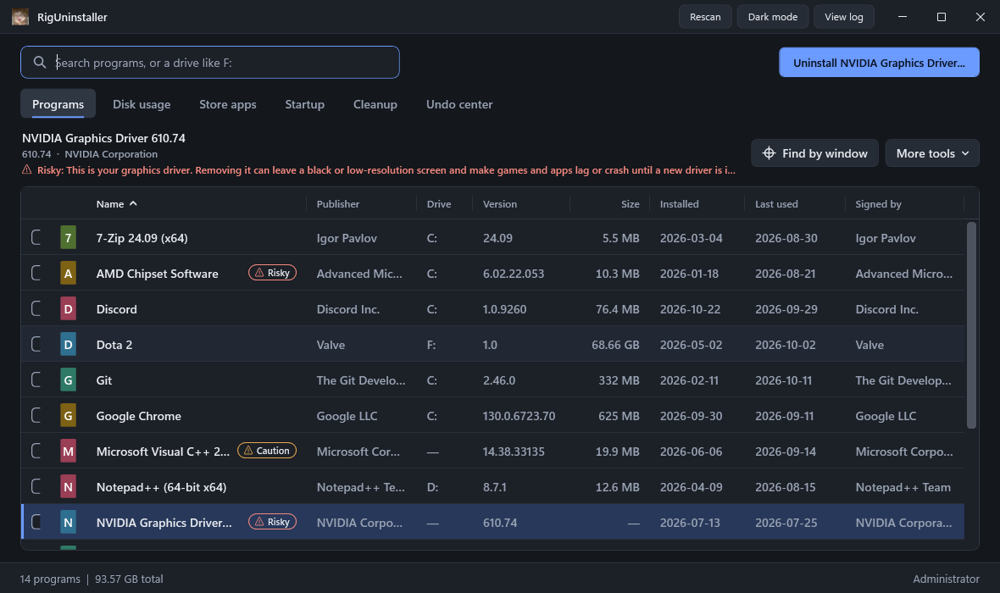
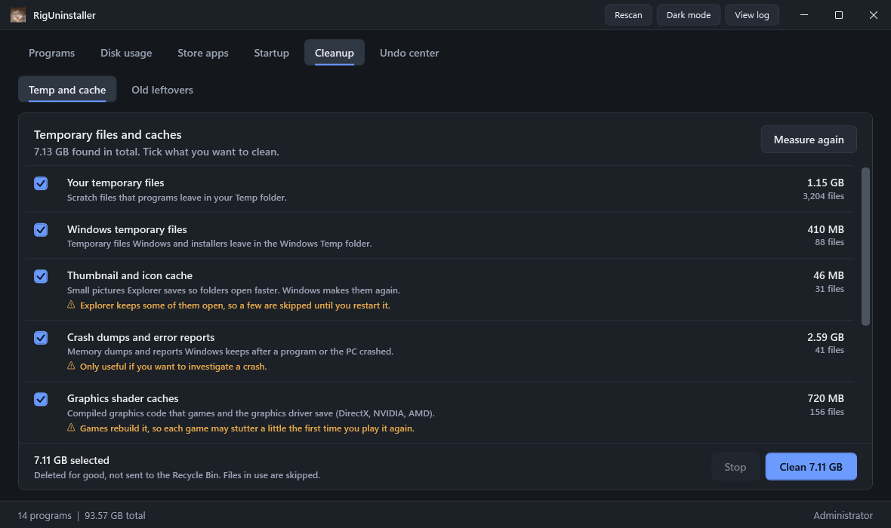
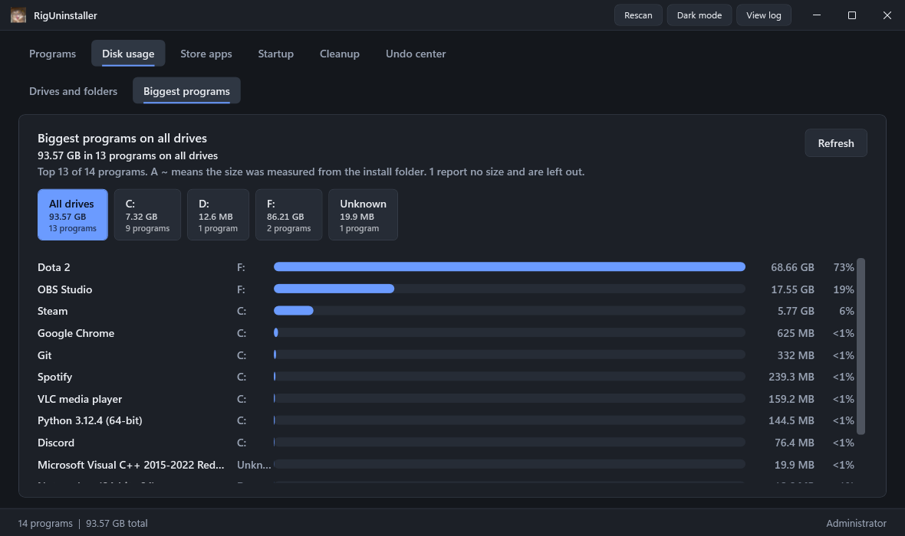
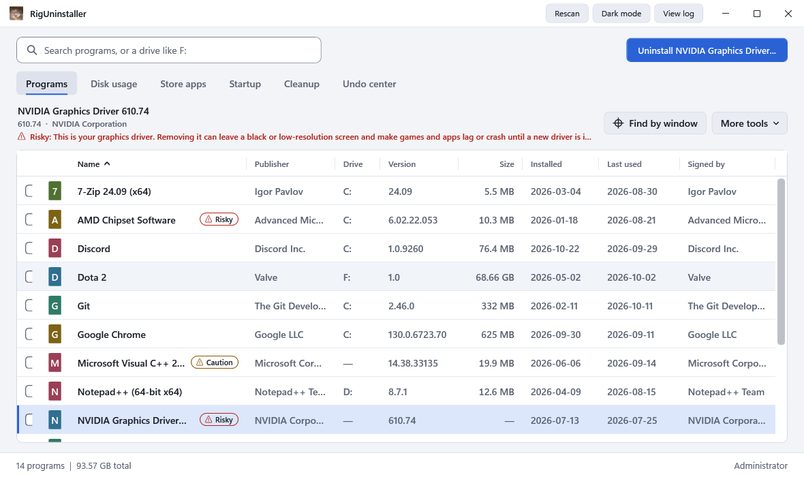

# RigUninstaller

A Windows uninstaller that cleans up after itself, tells you what is risky to remove, and can undo what it did.

It removes programs with their own uninstallers, then helps you find and remove what they left behind. It also clears temp files and caches, manages startup items, and shows what is using your disk space. Built with C# / .NET 8 / WPF. No paid libraries, no telemetry.



## Highlights

- **Uninstall properly.** Runs the program's own uninstaller (including MSI), waits for it and everything it starts, then rescans. Batch uninstall for many programs at once.
- **Finds leftovers.** After an uninstall it looks for files, folders, shortcuts and registry keys that belong to the removed program and rates each one High, Medium or Low. Nothing is removed until you tick it.
- **Warns before you break something.** Drivers, runtimes (.NET, Visual C++), security software and hardware tools carry a **Risky** or **Caution** tag with the reason, and ask first.
- **Undo center.** Every registry key is exported to a `.reg` file before it is touched, files go to the Recycle Bin, and restore points are offered. Restore from one list.
- **Cleanup tab.** Clears temp files, Windows Temp, thumbnail cache, crash dumps, shader caches, browser caches and more, and finds old folders that programs left behind.
- **Cleans up broken entries.** Programs whose files are already gone (so the uninstaller cannot run) are tagged and can be cleaned out of the list safely.
- **Light and dark theme**, remembered between runs, along with your sort order and window position.

| Cleanup: temp files and caches | Disk usage: biggest programs per drive |
|---|---|
|  |  |



## Requirements

- Windows 10 or 11, 64-bit
- [.NET 8 Desktop Runtime](https://dotnet.microsoft.com/download/dotnet/8.0) (to run); the .NET 8 SDK (to build)
- Administrator rights. The app asks for them when it starts (UAC prompt), because uninstallers and registry changes need them.

## Get it running

Build a single exe:

```
publish.cmd
```

It writes `publish\RigUninstaller.exe`. Windows SmartScreen may warn about it, because the exe is not code-signed. Run from source instead, in an **administrator** terminal:

```
dotnet run --project src\RigUninstaller
```

Run the tests:

```
dotnet test
```

(Add `-c Release` if the app is open: a running exe locks the Debug build.)

## A quick tour

| Where | What it does |
|---|---|
| **Programs** | Searchable, sortable list: icon, name, publisher, drive, version, size, install date, last used, who signed the uninstaller. Type a drive such as `F:` in the search box to see only that drive. Right-click for more. |
| **Uninstall** | Confirmation first, then the program's own uninstaller (`msiexec /x` for MSI). Optional quiet uninstall, restore point and Microsoft Defender scan. Warns if the program is running. |
| **Leftovers window** | After an uninstall: items that match the program or its publisher, rated High, Medium or Low. Low is hidden by default. |
| **Force remove** | Right-click. For programs whose uninstaller is missing or broken: removes the registry entry and the install folder, after a strong warning. |
| **Find by window** | Hold the crosshair button and drag onto any open window (or click it, then click the window). Its program is selected in the list. |
| **Track new install** | Take a snapshot, install something, finish tracking: the exact changes are saved and linked to the program, so its leftovers are removed precisely later. |
| **Disk usage** | Every drive with used and free space, folder-by-folder browsing, and a chart of the biggest programs with a button per drive and totals. Read-only. |
| **Store apps** | Lists Microsoft Store apps with their icons; remove them (frameworks and Windows' own packages are protected). |
| **Startup** | Run keys, Startup folders and logon tasks, with icons. Turn items off and on again (never deleted). **Add app...** makes a program start with Windows. |
| **Cleanup** | *Temp and cache*: tick the categories to clean. *Old leftovers*: folders in AppData, ProgramData and Program Files that no installed program owns. |
| **Undo center** | Every backup the app made (registry exports, Recycle Bin items, restore points, startup changes) with a Restore button. |
| **More tools** | Check winget (shows which programs winget knows and which have updates), export the list to CSV, edit the bloatware list, tick all bloatware. |
| **Keep** | Right-click a program and choose Keep: it cannot be uninstalled, force removed, batch removed or removed through winget. |

## Safety rules

- Everything that deletes goes through one gate (`SafetyGuard`): nothing inside `C:\Windows`, no drive roots, no `Program Files` itself, no Windows folders in Program Files, no `.sys` drivers, no network paths. Registry: only `HKLM\SOFTWARE` and `HKCU\Software`, never the Windows core keys, Classes or Policies.
- A System Restore point is offered before deleting.
- Every registry key is exported to a `.reg` file first, and is only deleted if the export worked.
- Files and folders go to the **Recycle Bin**. The one deliberate exception is the Cleanup tab's *Temp and cache*: those files are disposable and are deleted for good, after one confirmation. See below.
- Nothing is ever deleted automatically. You tick it, or you press the button.
- Every action is written to the log (**View log** button).

### What the cache cleaner can and cannot touch

It works from a fixed list of cache folders and deletes the **contents** only, never the folder. It never follows shortcuts or junctions, refuses protected folders (your profile, Documents, Downloads, the Windows folder as a whole...), and skips files that another program has open. Browser cleaning removes caches only: cookies, history and saved logins stay. Prefetch is not ticked by default, because Windows rebuilds it and programs can start a little slower afterwards. Cache cleaning cannot be undone, so the confirmation lists exactly what will go.

## Where it keeps things

Next to the exe, in `Data\` (so a new build in a new folder starts with an empty `Data`):

| File | What |
|---|---|
| `Logs\riguninstaller.log` | The action log. |
| `Backups\Registry\<time>_<program>\*.reg` | Registry exports. Double-click one to restore it. |
| `Backups\journal.jsonl` | The list the Undo center reads. |
| `Traces\*.json` | Install trace logs. |
| `keep.json`, `bloatware.json` | Your Keep tags and bloatware list. |
| `settings.json` | Theme, sort order and window position. |

## Things to know

- Sizes are what each program reports to Windows. Some report none; the Disk usage chart measures the install folder for those and marks them with `~`.
- "Last used" with a `~` is approximate (from file access times). The exact dates come from Windows Prefetch data, so clearing Prefetch makes them approximate too.
- A restore point can only be made once every 24 hours by default; the app says so and asks whether to go on.
- Removed Store apps can be installed again from the Microsoft Store.
- A **Broken entry** tag means the uninstaller file or install folder is gone. Use **Uninstall > Clean up entry** (or right-click > Force remove) to remove the leftover entry.
- The signature column leaves Windows components blank, because Windows protects them with catalog signatures.
- RigUninstaller itself sends nothing anywhere. It only runs `winget` and opens web searches when you ask it to.

## For developers

```
src\RigUninstaller        the app (WPF, MVVM written by hand)
  Models\                 plain data types
  Services\               scanning, uninstalling, cleaning, safety (all behind interfaces)
  ViewModels\             screens' logic, no UI types
  Views\ Themes\ Helpers\ XAML, light/dark styles, small UI helpers
tests\RigUninstaller.Tests   xUnit: 800+ tests with fakes for every service
tools\make-icon.ps1       turns a picture into src\RigUninstaller\Assets\app.ico
docs\screenshots          pictures used in this README (made from sample data)
```

Design notes:

- Real uninstallers, restore points, winget uninstalls and cache cleaning only ever run behind interfaces with fakes in tests. Tests that touch the machine only read it, or use their own temporary folders and keys.
- Both color themes are checked by a test for WCAG contrast (4.5:1 for text) and must define the same keys.
- To change the app icon: `powershell -File tools\make-icon.ps1 -Source <picture>`, then run `publish.cmd`.
